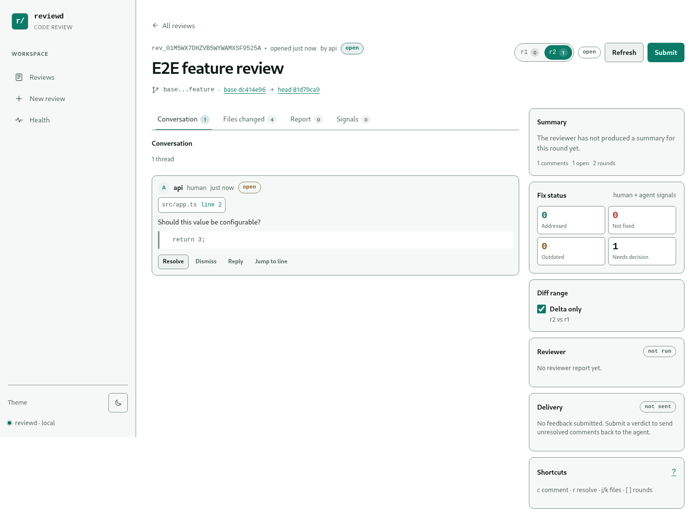
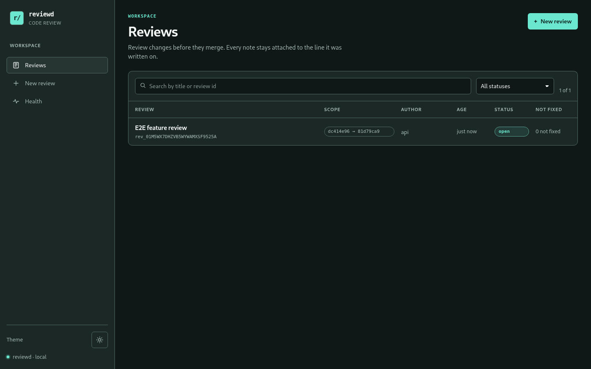

# dsh-code-review

Harness-agnostic code review control plane: independent agent pre-review, line-anchored
human comments, round-to-round fix tracking and feedback delivery back to the initiating
agent session. DSH, Claude Code, Codex, pi or a plain shell can drive the same daemon over
the authenticated HTTP/CLI contract. See `docs/design.md` for the full design.



## Quickstart

### Docker (recommended)

Requires Docker 26+ with Compose v2. Generate a token and start the stack; the daemon
binds `127.0.0.1:3100` by default.

```bash
TOKEN="$(openssl rand -hex 32)"
CODE_REVIEW_TOKEN="$TOKEN" CODE_REVIEW_PUBLIC_URL=http://127.0.0.1:3100 \
  docker compose up -d --build
docker compose ps
curl -fsS http://127.0.0.1:3100/api/health
```

Open <http://127.0.0.1:3100>, sign in with `$TOKEN`, and create a review. To keep the token
across restarts, copy `.env.example` to `.env`, put the generated token in it, and run
`docker compose up -d` without the inline variable. `.env` is gitignored; never commit it.

The image does not see host repositories by default. Mount a tree at the same absolute
path on both sides:

```bash
CODE_REVIEW_REPOS=/srv/repos \
  docker compose -f docker-compose.yml -f docker-compose.repo.yml up -d
```

See [docs/ops.md](docs/ops.md) for TLS/reverse proxy, token rotation, backup/restore,
retention, upgrades, logs and failure recovery. **Do not expose port 3100 to the public
internet directly:** there is one shared token and no account system.

### Local (Node 22)

```bash
pnpm install
pnpm build
export CODE_REVIEW_TOKEN="$(openssl rand -hex 32)"
export CODE_REVIEW_STORE=/tmp/code-review-store
node packages/server/dist/reviewd.js
# http://127.0.0.1:3100
```

Need a disposable repository and a ready-made review? Run `scripts/demo.sh` (see
[docs/demo.md](docs/demo.md)). It starts a daemon on a random port, creates a `base..feature`
review and prints the URL, then cleans up on Ctrl-C.

Or use the CLI, which starts the same server:

```bash
review serve --store /var/lib/code-review --public-url https://review.example
```

### DSH

Build first, then install the bundle through the profile plugin manager:

```bash
pnpm build
# plugin_manager install_bundle target=/absolute/path/to/dsh-code-review/packages/dsh
```

Configure `daemonUrl`, `token`, `worker` and `repoHint` in the profile patch; the full
key table, tool list, worker behaviour and delivery contract are in [docs/dsh.md](docs/dsh.md).
The bundle adds a sidebar panel, a keyed main panel, `review_*` tools, `/review`, the
reviewer worker and feedback delivery into the initiating session.

### CLI

Remote commands use `CODE_REVIEW_URL` (or `--daemon`) and `CODE_REVIEW_TOKEN`:

```bash
review start --repo /srv/repo --base main --reviewer worker --json
review status <id> --json
review comments add <id> --file src/a.ts --line 42 --body 'Please explain'
review feedback <id> --wait --format md
review submit <id> --request-changes --summary 'Address the blocker'
review refresh <id>
review health
```

`review diff` is local and needs no daemon. Exit codes: `0` ok, `2` timeout, `3` auth,
`4` daemon unavailable, `5` validation/not found, `6` conflict/stale/rate limited. See
[docs/daemon.md](docs/daemon.md).

## Screenshots

| Review list (dark)                               | Review detail (light)                                 |
| ------------------------------------------------ | ----------------------------------------------------- |
|  |  |

The standalone UI supports real git diffs, file and line comments (including per-line
full-file comments on current or base lines outside the diff), suggestions, rounds,
delta/full views, finding accept/dismiss decisions with inline notes, review and comment
editing/deletion, deep links, keyboard navigation, 320px layouts and light/dark themes.
The browser suite runs axe WCAG 2.1 A/AA checks and fails on serious or critical findings.

## What it does

- **Independent pre-review.** A reviewer worker reads the diff and surrounding code,
  posts findings with severities, questions and evidence, and can suggest edits.
- **Human control.** Comments are anchored to a file/side/line or range with a quote,
  context and content hash. They survive force-pushes and renames by re-anchoring; the
  previous and current locations are both shown. Reviewers can accept or dismiss agent
  findings; the latest decision and its optional inline note are persisted and shape the
  next feedback package. Mistaken review metadata or comment text can be corrected while the
  review is open; changing the scope starts a new immutable round. Reviews and comments
  can be soft-deleted without erasing their audit events.
- **Fix tracking.** Every refresh creates an immutable round. Deterministic rules classify
  comments as `applied`, `addressed`, `unchanged`, `outdated` or `moved`; agent claims and
  reviewer verification are separate signals, not silent truth.
- **Feedback to the right agent.** Submitting produces a deterministic markdown/JSON
  package and a delivery key. The initiating DSH session receives it through
  `sessionController.prompt`; CLI/other harnesses can read the same feedback.
- **No hidden writes.** The reviewer is read-only. Suggestions are applied only by an
  explicit human action against the expected snapshot, with a stale check.

## Security model

- One shared bearer token (`CODE_REVIEW_TOKEN`, 32+ bytes), required at startup and never
  logged or baked into the image. Browsers exchange it for an HttpOnly, SameSite=Strict
  cookie; machine clients use `Authorization: Bearer`.
- Health/version are public; all review data is authenticated. Mutations reject
  cross-origin requests; there is no CORS. Rate limits and body/diff/snapshot caps bound
  resource use.
- `reviewd` is plain HTTP. Terminate TLS at a reverse proxy and keep the listener on
  loopback or a private network. There are no per-user accounts or token revocation lists.
- Reviewer output and comments are untrusted data. Rendering is safe text/code; reviewer
  tools use a read-only allowlist; command backends run as a trusted operator boundary with
  `shell:false`, a minimal environment (no inherited `CODE_REVIEW_TOKEN`), bounded output
  and process-group termination on timeout.
- Git access removes inherited repository environment, disables external diff/textconv and
  validates paths against the repository root. Symlinks leading outside are not followed.
- The container runs non-root with a read-only rootfs, all capabilities dropped and a
  writable `/data` volume. See [SECURITY.md](SECURITY.md).

## Limitations

- No bundled model or agent CLI in the image. You need a DSH worker, a command backend, or
  your own reviewer integration; `none` is explicit and records a skipped report.
- Single-tenant by design: one token, no accounts, no per-user audit identity, no hosted
  control plane. Use a VPN/reverse proxy for teams.
- TLS, backups, retention scheduling and log shipping are deployment responsibilities;
  `review gc` is manual. See [docs/ops.md](docs/ops.md).
- MCP and native adapters for harnesses other than DSH are not shipped yet; the HTTP API
  and CLI are the stable integration surface.
- The event store is a single-writer local filesystem store; there is no HA/clustering.
- The image is Linux/amd64-oriented; ARM images are rebuildable from the Dockerfile but not
  published as a multi-arch manifest in this release.
- Apply suggestion requires a writable repository mount and a human action; there is no
  automatic commit/push.

## Status

Plans 1–6: the git diff/snapshot foundation, the C3 review-state library
(event store, rounds, anchors, outcomes), C4 (`ReviewServiceImpl`, feedback package,
reviewer contract/backends), C5 (`reviewd` HTTP/SSE/long-poll daemon, workers/jobs,
deliveries and the remote `review` CLI), the standalone review UI served by the daemon,
the DSH Cordis bundle (sidebar panel, tools, `/review`, reviewer worker and feedback
delivery), and the Docker/Compose deployment plus OSS packaging surface (CI, operations,
security policy, changelog and demo). See `docs/dsh.md` for DSH installation and
`docs/ops.md` for deployment.

## Review state (C3)

The review state is a library in `@dsh-code-review/core`; it has no daemon, network, UI
or DSH imports. A store root contains:

```text
lock                              single-writer lock (pid + createdAt)
reviews/<reviewId>/events.jsonl   append-only, versioned event log (source of truth)
reviews/<reviewId>/snapshot.json  atomically replaced replay cache
snapshots/<snapshotId>.json       immutable round snapshots
deliveries.json                   durable feedback delivery outbox
stream-cursor.json                durable daemon-wide SSE high-water mark
```

`ReviewStore.open(root)` takes the lock and rejects a live owner; a stale lock must be
removed manually. Every mutation appends one JSON event under a per-review mutex, fsyncs it, folds it
into the aggregate and then best-effort replaces the cache. Replay is authoritative: a torn final JSONL
line is truncated on the next append and reported as `torn-tail`; corruption before the
last line fails with the review id and line number. `ReviewLifecycle` owns review/round/
comment mutations, replies, soft states and refresh.

Rounds are immutable and snapshots are stored by id. `refresh` writes the next snapshot,
re-anchors every comment (following renames, hunk-mapped old lines and a ±40-line quoted
search, with suggestion replacement as a fallback), records an anchor plus a
deterministic outcome (`applied`, `addressed`, `unchanged`, `outdated`, `moved`) with
confidence, and preserves comment ids, bodies, replies and anchor history. Comments are
never physically deleted; `resolved`/`dismissed` are states. C3 is intentionally not the
reviewer/HTTP layer.

## Review service and reviewer contract (C4)

`ReviewServiceImpl` is the application interface above C3. Transports (HTTP, CLI, DSH) map
requests to it; it has no `node:http`, React, Cordis or DSH imports.

```ts
import { ReviewLifecycle, ReviewServiceImpl, ReviewStore } from '@dsh-code-review/core';

const store = await ReviewStore.open('/var/lib/code-review');
const lifecycle = new ReviewLifecycle(store);
const service = new ReviewServiceImpl({
  lifecycle,
  store,
  snapshots: { build: ({ repoRoot, scope }) => buildSnapshot({ repoRoot, scope }) },
});

const view = await service.create(
  {
    repoRoot: '/srv/repo',
    title: 'Feature review',
    scope: { kind: 'range', baseRef: 'main', headRef: 'feature' },
    reviewer: { backend: 'none' },
  },
  { actor: { name: 'Ada', kind: 'human' }, requestId: 'create-1' },
);

const comment = await service.addComment(
  view.review.id,
  { body: 'This loses the last item', path: 'src/a.ts', side: 'new', lineStart: 42 },
  { actor: { name: 'Ada', kind: 'human' }, requestId: 'comment-1' },
);

const report = await service.runReviewer(view.review.id, {
  actor: { name: 'Reviewer', kind: 'agent' },
});
const submission = await service.submit(
  view.review.id,
  { verdict: 'request-changes', summary: 'Please address the blocker' },
  { actor: { name: 'Ada', kind: 'human' }, requestId: 'submit-1' },
);
console.log(submission.feedback.markdown, submission.deliveryKey);
```

All mutations take `CallContext { actor, requestId? }`; repeating the same `requestId` for
the same operation and review on one service instance returns the same result and appends
once. Concurrent retries are serialized, and a `requestId` reused on a different operation
or review does not return another route's result. Errors are `ReviewError` with
`code` in `not-found | validation | conflict | agent-busy | stale-review | internal`.

### Feedback contract

`submit` appends `review/submitted` and returns a deterministic markdown + JSON package
(no timestamps or random values). Both the markdown and the JSON are capped at 100 KiB;
the JSON gets `truncated: true` and a notice when items must be dropped. It includes open human comments, open blocker/major findings,
accepted findings (all non-praise severities), dismissed findings with their notes, accepted
and applied suggestions (applied ones are marked “do not reapply”), questions, verification
entries and a resolved summary. `deliveryKey` is `reviewId:round:submissionId` and is stable
for delivery idempotency. An `approve` verdict closes the review; other verdicts keep it
open. A round can be submitted once.

`FeedbackJson` (schemaVersion 1):

```json
{
  "schemaVersion": 1,
  "reviewId": "rev_…",
  "round": 2,
  "verdict": "request-changes",
  "title": "Feature review",
  "scope": { "baseSha": "…", "headSha": "…", "label": "main..feature" },
  "deliveryKey": "rev_…:2:sub_…",
  "findings": [
    {
      "id": "f1",
      "severity": "blocker",
      "file": "src/a.ts",
      "lineStart": 42,
      "lineEnd": 42,
      "title": "…",
      "rationale": "…",
      "evidence": "…",
      "decision": "accepted",
      "note": "Please fix this before merge."
    }
  ],
  "dismissedFindings": [],
  "humanComments": [
    { "commentId": "cmt_…", "path": "src/a.ts", "lineStart": 42, "lineEnd": 42, "body": "…" }
  ],
  "appliedSuggestions": [],
  "acceptedSuggestions": [],
  "questions": [],
  "verification": [],
  "resolved": { "count": 1, "commentIds": ["cmt_…"] }
}
```

### Reviewer contract

`ReviewerBackend.run(job, sink, signal)` returns a `ReviewerReport`; findings stream through
`FindingSink`. `validateReport(raw, { snapshot })` is dependency-free and rejects invalid
items individually (duplicate ids, bad enums, missing snapshot paths, out-of-range lines,
texts over 32 KiB, more than 200 findings / 50 questions), keeping the rest. A suggestion
whose `original` does not match the snapshot after whitespace normalization is dropped and
the finding is marked `unanchored`.

`runReviewer` persists `agent/started`, `agent/finding`, `agent/report` (or `agent/failed`),
exposes `ReviewView.report`, and rejects a concurrent run with `agent-busy`. The `none`
backend records a skipped report; `cancelAgent` aborts an active run and records failure.
`FakeReviewer` is deterministic for tests. `CommandReviewer` runs an argv array only (no
shell), with `{promptFile}`, `{repo}`, `{outputFile}` and `{reviewId}` placeholders, a
timeout, captured stdout/stderr, last-fenced-JSON fallback, and before/after
`git status --porcelain` via an injected runner; it sets `dirtyWorktree` and never writes
the repository itself.

## Daemon and CLI (C5)

`reviewd` exposes the service over authenticated HTTP. Start it with a 32+ byte token and a
store directory:

```bash
export CODE_REVIEW_TOKEN="$(openssl rand -hex 32)"
export CODE_REVIEW_STORE=/var/lib/code-review
node packages/server/dist/reviewd.js
# or: review serve --store /var/lib/code-review --public-url https://review.example
```

Machine clients use `Authorization: Bearer $CODE_REVIEW_TOKEN`; browsers can exchange the
token for the HttpOnly `cr_session` cookie at `/api/auth`. Health and version are public.
Everything else is behind auth, mutations are same-origin, and per-peer rate limits return
`429` with `Retry-After`. Errors are `{error:{code,message,details?}}` with the daemon
codes (`unauthorized`, `validation`, `not-found`, `conflict`, `stale-review`, `agent-busy`,
`rate-limited`, `internal`, …).

The daemon provides review REST routes, a 25s long-poll/SSE event stream, worker
registration/heartbeat, 60-second job leases with `attemptId` idempotency, and a delivery
queue keyed by `reviewId:round:submissionId`. Review state stays in the C3 event log; worker
steps are appended as `agent/*` events. See `docs/daemon.md` for endpoint payloads, curl
examples, the worker loop and the delivery contract.

```bash
review start --repo /srv/repo --base main --reviewer worker --json
review status <id> --json
review feedback <id> --wait --format md
review comments add <id> --file src/a.ts --line 42 --body 'Please explain'
review submit <id> --request-changes --summary 'Address the blocker'
review health
review gc --older-than 90d
```

`review diff` remains a local command and is unchanged. Remote commands take `--daemon`
or `CODE_REVIEW_URL` and `CODE_REVIEW_TOKEN` (or `~/.config/code-review/config.json`,
mode `0600`). Exit codes: `0` ok, `2` timeout, `3` auth, `4` daemon unavailable, `5`
validation, `6` conflict/stale. `review serve` and the built `reviewd` entry print the
listener URL and shut down cleanly on SIGINT/SIGTERM.

## Review UI

`pnpm build` builds the core package, the Vite web app into `packages/web/dist`, and the
server CLI/daemon. `reviewd` serves that SPA on the same authenticated origin as the API:

- `/` — review list with status and search filters.
- `/review/<id>?round=N#file=<path>&line=<n>` — conversation, changed files, round switch,
  delta/full diff, line comments and submit/refresh controls.
- `/new` — create a review from a repository and range.
- `/auth` — exchange `CODE_REVIEW_TOKEN` for the HttpOnly `cr_session` cookie.
- `/health` — daemon health.

Set `CODE_REVIEW_WEB_DIR` to serve a different built SPA directory. The daemon resolves
`packages/web/dist` automatically in a source checkout and prints the listener URL; if the
directory is missing it serves a small diagnostic page instead of failing API requests.
Unknown SPA deep links fall back to `index.html`, while unknown `/api/*` routes keep their
JSON 404. Hashed files under `/assets/` are cached immutably; `index.html` and other static
files use `no-store`. Static responses set a strict CSP (`default-src 'self'; script-src
'self'; style-src 'self' 'unsafe-inline'; img-src 'self' data:; connect-src 'self';
frame-ancestors 'none'`), `Referrer-Policy: no-referrer`, `X-Content-Type-Options: nosniff`
and `X-Frame-Options: DENY`.

For manual UI work, build once and start the daemon with a store:

```bash
pnpm install
pnpm build
CODE_REVIEW_TOKEN="$(openssl rand -hex 32)" \
CODE_REVIEW_STORE=/tmp/code-review-store \
node packages/server/dist/reviewd.js
```

The browser flow uses the token only at `/auth`; subsequent API calls use the session
cookie. The Playwright suite starts the built `reviewd` with a temporary store and a
temporary git repository, seeds a review and exercises login, list/detail, diff comments,
replies, resolve, rounds, deep links, keyboard shortcuts, 320/1440 layouts and light/dark
screenshots. It also runs axe WCAG 2.1 A/AA scans and fails on serious or critical
findings:

```bash
pnpm test:e2e    # build + full Chromium suite
pnpm test:a11y   # build + axe-tagged tests only
```

Screenshots are written to `test-results/screens/` and the Playwright HTML report to
`playwright-report/`; both are generated artifacts and are gitignored. Chromium is the
only browser dependency (`pnpm exec playwright install chromium`).

## Development

```bash
pnpm install
pnpm verify
```

## Snapshot CLI

Build once, then inspect a repository without a daemon:

```bash
pnpm build
node packages/server/dist/cli.js diff \
  --repo /path/to/repo --base main --head HEAD --json > snapshot.json
```

The JSON shape is stable for Plan 1:

```json
{
  "schemaVersion": 1,
  "scope": { "kind": "range", "baseSha": "…", "headSha": "…", "worktreeDigest": "…" },
  "files": [
    {
      "path": "src/a.ts",
      "status": "modified",
      "binary": false,
      "oversized": false,
      "added": 2,
      "deleted": 1,
      "hunks": [],
      "contentHash": "…"
    }
  ],
  "totals": { "files": 1, "added": 2, "deleted": 1, "truncated": false },
  "warnings": []
}
```

`status` is always the actual change kind (`added`, `modified`, `deleted`, `renamed`,
`submodule` or `untracked`). Content conditions are separate flags:

- `binary` — NUL bytes or invalid UTF-8; `encoding` is `"unknown"` for the latter.
- `oversized` — the file exceeded the line or per-file content cap; no lines and no hash.
- `ignored` — matched `--ignore`; the file stays visible but has no content or hash.
- `truncated` — content was omitted by the snapshot-wide content budget or because the file
  lies beyond the diff cap; no lines and no hash.
- `reason` — `"unreadable"` when a per-file read failed (for example `EACCES` or an `ENOENT`
  race), or `"diff-truncated"` when metadata was recovered after the file fell beyond the
  diff cap. The file stays visible and the snapshot continues.

`contentHash` is a SHA-256 of the raw bytes when content was retained. It is `null` for
`--no-content`, oversized, ignored, budget/diff-truncated and unreadable entries, and for
submodules. `--no-content`, ignored files, oversized files and files recovered from raw
metadata do not trigger content reads; budget truncation, diff backfill and unreadable files
add warnings.

`--worktree` diffs the base against the working tree (staged, unstaged and, by default,
untracked files; `--no-untracked` excludes untracked files). `--commit <sha>` diffs a commit
against its first parent; a root commit uses the empty tree, while a commit whose parent is
missing (for example a shallow boundary) fails with a fetch/unshallow error instead of
silently pretending every file was added. A selected commit set is a `commits` scope with
`shas` ordered oldest to newest; it diffs the newest commit against the first parent of the
oldest, so commits between the endpoints are included. `--two-dot`, `--max-files`,
`--max-lines` and `--ignore <glob>` are available for large repositories. `--max-files`
caps reviewable files; ignored entries remain visible and never consume that cap.

### Repository settings and merge requests

`/settings` in the web UI stores named local checkouts and an optional default target
branch. The daemon persists them in `<store>/repositories.json` (mode `0600`) and exposes
them at `GET/PUT /api/settings/repositories`; every path is resolved as a git checkout
before it is saved. `/new` then starts a merge-request review by choosing a saved
repository, a source branch, a target branch, and either all commits on the source side of
the merge base or an inclusive set of commits. reviewd records that boundary only: it
never merges, checks out, or rewrites the target branch. `GET /api/repos/commits` returns
the commits between the target and source branches for that picker.

Limits: 2 MiB of diff text, 500 files, 20 000 lines per file, 1 MiB of content per file and
64 MiB of content per snapshot, and untracked path listings at 8 MiB. `totals.truncated`
is true for diff, file-count, content-budget or untracked-listing truncation. A file cut by
the diff cap remains visible as an `oversized`
synthetic entry; every changed path wholly beyond the cap is recovered from one `--raw -z`
metadata call as a `truncated`/`diff-truncated` entry with no content or hash. Backfilled
entries report `binary:false` because their content was not read; treat `truncated` and
`reason:"diff-truncated"` as authoritative. Reports include
`diff-truncated`, `diff-file-truncated:<path>`, `diff-file-skipped:<path>`,
`files-truncated`, `content-budget-truncated`, `worktree-digest-truncated`,
`untracked-list-truncated`, `symlink-not-followed:<path>` and `unreadable:<path>` where
relevant. A truncated untracked listing continues with the paths returned before the cap.
`scope.worktreeDigestTruncated` is present when the digest itself had to be computed from
truncated status/diff output or an overflowing untracked path listing.

For a worktree, `worktreeDigest` also hashes untracked file contents. The digest is versioned
and length-framed: status/diff byte fields and per-file records carry explicit tags and byte
lengths, and per-file records distinguish regular files, symlinks and unreadable paths. Paths
are sorted by UTF-8 bytes; regular files are opened with `O_NOFOLLOW` and streamed from the
handle; symlinks hash their link target rather than the target contents; unreadable or raced
paths hash a stable marker. On Linux the opened descriptor is verified through
`/proc/self/fd/<fd>` against the precomputed repository realpath, so a parent-directory swap
cannot redirect the read. Platforms without procfs fall back to `realpath(pathname)`, which
retains the parent-symlink TOCTOU limitation. Both the digest and the snapshot cap their untracked path
listing at 8 MiB; digest overflow sets `worktreeDigestTruncated`, while snapshot overflow
adds `untracked-list-truncated` and marks totals truncated. Untracked content itself is not
capped.

The human output prefixes the change letter with `I` (ignored), `B` (binary) or `L`
(oversized), for example `IM src/a.ts` or `B? image.bin`.

Git commands are read-only. They run with `--no-pager`, fixed diff prefixes and config
overrides, no external diff or textconv drivers, `GIT_CONFIG_NOSYSTEM=1`, and with inherited
`GIT_DIR`/`GIT_WORK_TREE`/`GIT_INDEX_FILE` removed. Flags take a separate value
(`--base main`); `--flag=value` and `--` are not supported.

Exit codes: `0` success, `1` internal failure, `5` usage, git validation or an unsupported
diff (for example an ambiguous path header).
