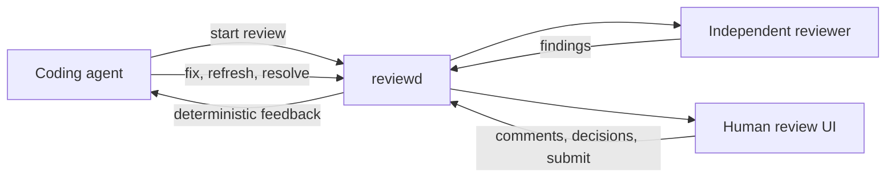

<div align="center">

# reviewd

**An agent-native code review control plane.**

Independent AI pre-review, line-anchored human comments, round tracking, and a clean
feedback loop back to the coding agent that opened the review.

[](https://github.com/AKhasa9ov/reviewd/actions/workflows/ci.yml)
[](LICENSE)
[](https://nodejs.org/)

[Quick start](#quick-start) · [Documentation](docs/README.md) · [Agent guide](AGENTS.md) · [Architecture](docs/architecture.md)


</div>

## Why reviewd

Coding agents are good at opening a change and bad at closing the loop around it. reviewd
gives the change a durable review surface:

- an independent reviewer can inspect the diff before a human does;
- a human can leave precise, line-anchored comments and accept or dismiss findings;
- the next agent pass gets deterministic markdown/JSON feedback instead of a chat summary;
- every round, decision and resolution stays in an audit-friendly event log.

reviewd is **self-hosted** and **harness-agnostic**. DSH gets a native panel and tools;
Claude Code, Codex, pi and a plain shell use the same authenticated CLI/HTTP contract.
It is not a GitHub/GitLab replacement — it is the review layer for agent-driven work.

## What it does

### Independent pre-review

A reviewer worker reads the diff and surrounding code, then posts structured findings with
severity, evidence, questions and optional suggestions. The reviewer is read-only: it
cannot edit the repository or write review state outside its defined events.

### Review that survives force-pushes

Comments are anchored to a file, side, line or range, with a quote and content hash. When
the source changes, the next round re-anchors them by rename, hunk mapping and quoted
context. Previous and current locations are both visible. Comments are never physically
deleted; `resolved` and `dismissed` are states, not destructive actions.

### Close the loop with a fix agent

Submit a review and reviewd produces a deterministic feedback package: open human
comments, accepted findings, dismissed findings with notes, suggestions, questions and
verification entries. A DSH fixer can call `review_feedback`, then `review_refresh`, then
`review_resolve_comment` after the fix. CLI and HTTP clients get the same contract.

### Harness-agnostic by design

The daemon owns review state and the HTTP contract. The DSH bundle adds a sidebar panel,
`review_*` tools, `/review`, a reviewer worker and feedback delivery. Other harnesses call
the `review` CLI or the documented HTTP API. No MCP adapter is required — or shipped yet.

### Auditable, self-hosted state

Reviews live in an append-only `events.jsonl` per review. Rounds are immutable snapshots;
replay is authoritative and `snapshot.json` is a cache. One token protects the deployment;
review data is never sent to a hosted service.

## See it

| Review list                                                              | Review detail                                                               |
| ------------------------------------------------------------------------ | --------------------------------------------------------------------------- |
|  |  |

| Submit and hand off                                                                  |
| ------------------------------------------------------------------------------------ |
|  |

The UI supports real git diffs, file and line comments, drag-selected ranges, suggestions,
round switching, delta/full views, finding decisions, deep links, keyboard navigation,
320px layouts and light/dark themes. The browser suite runs axe WCAG 2.1 A/AA checks.

## Quick start

### Docker (recommended)

Requires Docker 26+ with Compose v2. The stack binds `127.0.0.1:3100` by default.

```bash
TOKEN="$(openssl rand -hex 32)"
CODE_REVIEW_TOKEN="$TOKEN" CODE_REVIEW_PUBLIC_URL=http://127.0.0.1:3100 \
  docker compose up -d --build
docker compose ps
curl -fsS http://127.0.0.1:3100/api/health
```

Open <http://127.0.0.1:3100>, sign in with `$TOKEN`, and create a review. Keep the token
across restarts by copying `.env.example` to `.env`; `.env` is gitignored.

The image only sees repositories you mount. See
[Deploy reviewd](docs/guides/deploy.md) for repository mounts, TLS, token rotation,
backups, retention and upgrades. **Do not expose port 3100 directly to the public
internet:** there is one shared token and no account system.

### Local (Node 22)

```bash
pnpm install
pnpm build
export CODE_REVIEW_TOKEN="$(openssl rand -hex 32)"
export CODE_REVIEW_STORE=/tmp/code-review-store
node packages/server/dist/reviewd.js
# http://127.0.0.1:3100
```

Need a disposable repository and a ready-made review? Run `scripts/demo.sh`; it starts a
daemon on a random port, creates a `base..feature` review and prints the URL.

### DSH

```bash
dsh plugin --profile web add @dsh-code-review/dsh
```

Restart the profile so Host routes and loops load. Embedded mode is the default: the
bundle starts `reviewd` in-process and serves the review UI at `/code-review` behind DSH
session auth. See [DSH integration](docs/agents/dsh.md) for configuration, tools, worker
and data retention.

> **Release status:** `0.1.0` is a release candidate. Docker and source checkouts are ready.
> npm publication is pending registry credentials; the DSH package can still be installed
> from a local tarball with `pnpm fat:verify`.

### CLI

After `pnpm build`, the CLI is at `packages/server/dist/cli.js`; once the npm packages are
published it will be available as `review` from `@dsh-code-review/server`.

```bash
review start --repo /srv/repo --base main --reviewer worker --json
review status <id> --json
review comments add <id> --file src/a.ts --line 42 --body 'Please explain'
review feedback <id> --wait --format md
review submit <id> --request-changes --summary 'Address the blocker'
review refresh <id>
review health
```

Remote commands use `CODE_REVIEW_URL` (or `--daemon`) and `CODE_REVIEW_TOKEN`. `review diff`
is local and needs no daemon. See the [CLI reference](docs/reference/cli.md) for the full
command surface and exit codes.

## Documentation

| I want to…                                  | Start here                                                                            |
| ------------------------------------------- | ------------------------------------------------------------------------------------- |
| Understand the product                      | [Features](docs/features.md)                                                          |
| Install and create my first review          | [Quick start](docs/getting-started/quickstart.md)                                     |
| Review a change as a human                  | [Review a change](docs/guides/review-a-change.md)                                     |
| Run a fix agent against review feedback     | [Run a fix agent](docs/guides/run-a-fix-agent.md)                                     |
| Connect DSH, Claude Code, Codex, pi or HTTP | [Connect an agent](docs/guides/connect-an-agent.md)                                   |
| Deploy and operate reviewd                  | [Deploy](docs/guides/deploy.md)                                                       |
| Look up commands or HTTP routes             | [CLI](docs/reference/cli.md) · [HTTP API](docs/reference/http-api.md)                 |
| Understand the internals                    | [Architecture](docs/architecture.md) · [Review state](docs/reference/review-state.md) |
| Work on the code                            | [CONTRIBUTING.md](CONTRIBUTING.md)                                                    |

The complete documentation index is [docs/README.md](docs/README.md). Agents that use
reviewd should start at [AGENTS.md](AGENTS.md); a machine-readable index is at
[llms.txt](llms.txt).

## How it works



The daemon owns the review lifecycle; the UI, CLI, DSH bundle and workers are adapters over
the same service. See [Architecture](docs/architecture.md) for components and data flow.

## Security model

- One shared bearer token (`CODE_REVIEW_TOKEN`, 32+ bytes), required at startup and never
  logged or baked into the image. Browsers exchange it for an HttpOnly, SameSite=Strict
  cookie; machine clients use `Authorization: Bearer`.
- Health and version are public; all review data is authenticated. Mutations reject
  cross-origin requests; there is no CORS. Rate limits and body/diff/snapshot caps bound
  resource use.
- `reviewd` is plain HTTP. Terminate TLS at a reverse proxy and keep the listener on
  loopback or a private network. There are no per-user accounts or token revocation lists.
- Reviewer output and comments are untrusted data. Rendering is safe text/code; reviewer
  tools use a read-only allowlist; command backends run without a shell, with a minimal
  environment and bounded output.

See [SECURITY.md](SECURITY.md) for the full threat model and reporting process.

## Status and limitations

- **0.1.0 release candidate.** API/schema version 1; no automatic event-schema migrations.
- Single-tenant by design: one token, no accounts, no hosted control plane.
- No bundled model or agent CLI; bring a DSH worker, command backend or your own reviewer.
- Native adapters exist for DSH only. Claude Code, Codex, pi and other harnesses use the
  CLI/HTTP contract; MCP is not shipped.
- The event store is a single-writer local filesystem store; there is no HA/clustering.
- The image is Linux/amd64-oriented; multi-arch manifests are not published.
- npm publication of `@dsh-code-review/*` is pending registry credentials.

## License

[MIT](LICENSE)
