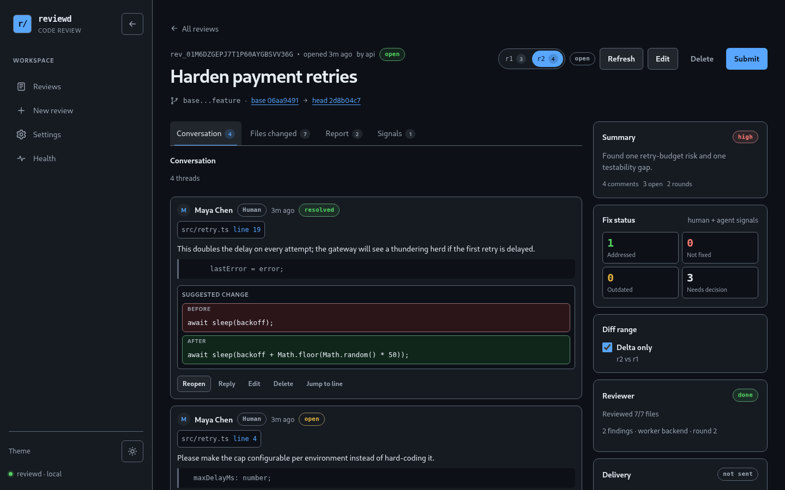
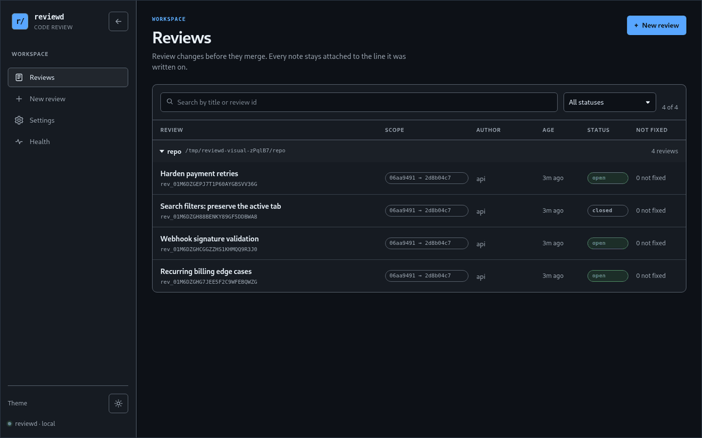
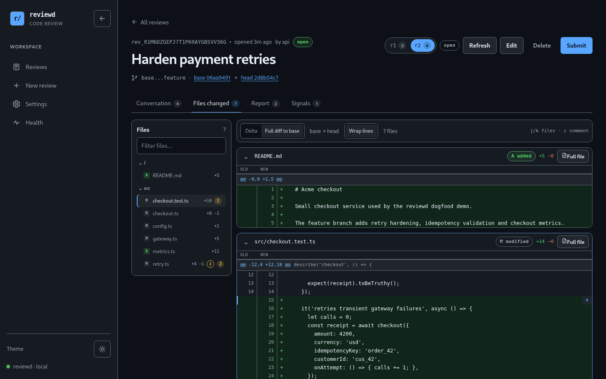
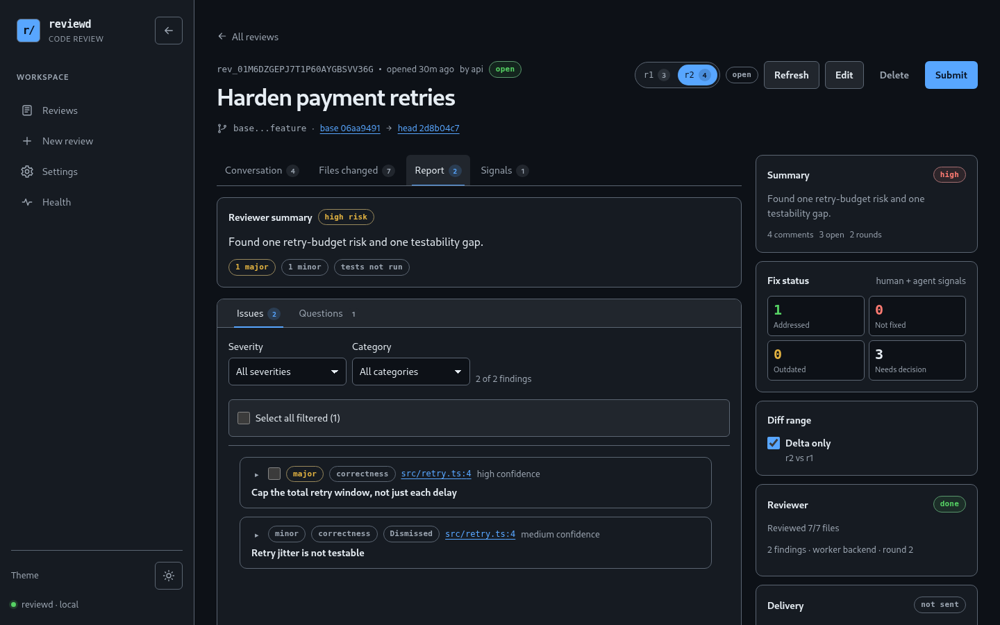
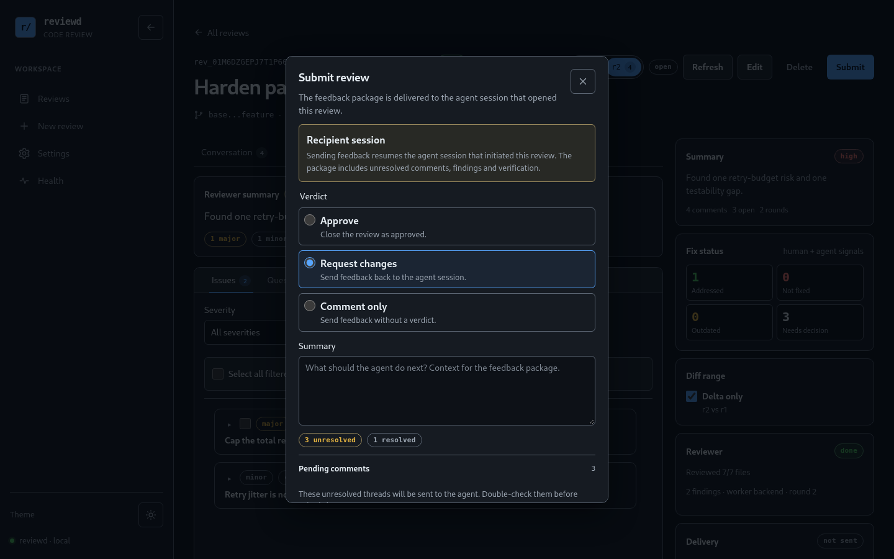
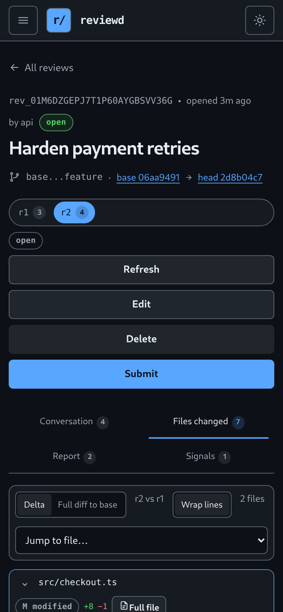
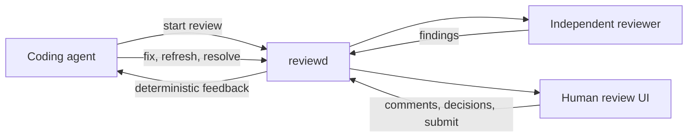

<div align="center">

# reviewd

**An agent-native code review control plane.**

Independent AI pre-review, line-anchored human comments, round tracking, and a clean
feedback loop back to the coding agent that opened the review.

[](https://github.com/AKhasa9ov/reviewd/actions/workflows/ci.yml)
[](LICENSE)
[](https://nodejs.org/)
[](https://www.npmjs.com/package/@sir_yami/reviewd)

[Quick start](#quick-start) · [npm packages](#npm-packages) · [Features](docs/features.md) · [Documentation](docs/README.md) · [Agents](AGENTS.md)



<sub>A real review after a fix round: one thread addressed, three decisions still open, and every
comment still attached to its line.</sub>

</div>

## See it in motion

<p align="center">
  
</p>

<p align="center">
  <sub><a href="docs/images/reviewd-walkthrough.webm">Open the 13-second WebM walkthrough</a> · the flow from queue to handoff, recorded on the real UI.</sub>
</p>

## Why reviewd

Coding agents are good at opening a change and bad at closing the loop around it. reviewd
gives the change a durable review surface:

- an independent reviewer can inspect the diff before a human does;
- a human can leave precise, line-anchored comments and accept or dismiss findings;
- the next agent pass gets deterministic markdown/JSON feedback instead of a chat summary;
- every round, decision and resolution stays in an audit-friendly event log.

reviewd is **self-hosted** and **harness-agnostic**. DSH gets a native panel and tools;
Claude Code, Codex, pi and a plain shell use the same authenticated CLI/HTTP contract.
It is not a GitHub/GitLab replacement — it is the review layer for agent-driven work.

## npm packages

The public packages are published on npm under the `@sir_yami` scope:

| Package                                                                              | Latest                                                                                                                                        | Install                                          | Role                         |
| ------------------------------------------------------------------------------------ | --------------------------------------------------------------------------------------------------------------------------------------------- | ------------------------------------------------ | ---------------------------- |
| [`@sir_yami/reviewd`](https://www.npmjs.com/package/@sir_yami/reviewd)               | [](https://www.npmjs.com/package/@sir_yami/reviewd)               | `dsh plugin --profile web add @sir_yami/reviewd` | DSH bundle                   |
| [`@sir_yami/reviewd-server`](https://www.npmjs.com/package/@sir_yami/reviewd-server) | [](https://www.npmjs.com/package/@sir_yami/reviewd-server) | `npm install -g @sir_yami/reviewd-server`        | daemon, API and `review` CLI |
| [`@sir_yami/reviewd-core`](https://www.npmjs.com/package/@sir_yami/reviewd-core)     | [](https://www.npmjs.com/package/@sir_yami/reviewd-core)     | `npm install @sir_yami/reviewd-core`             | TypeScript library           |

These are layers, not three alternatives. Install the one that matches where the review
should live.

### What should I install?

| Situation                                                               | Install                                                                                             |
| ----------------------------------------------------------------------- | --------------------------------------------------------------------------------------------------- |
| Review inside DSH, with no separate service                             | `@sir_yami/reviewd`                                                                                 |
| DSH panel backed by a shared daemon                                     | `@sir_yami/reviewd-server` on the daemon host and `@sir_yami/reviewd` in DSH with `embedded: false` |
| Standalone browser UI                                                   | Docker Compose, which includes the web build; the npm server package is API/CLI-first               |
| CLI or HTTP API for agents, CI and remote machines                      | `@sir_yami/reviewd-server`                                                                          |
| Custom TypeScript adapter, or embedding review state in another process | `@sir_yami/reviewd-core`                                                                            |

### What each package contains

**`@sir_yami/reviewd` — DSH integration.** Start here if you use DeepSeek Harness. The
bundle brings the sidebar panel, the `review_*` tools, a reviewer worker, feedback delivery
and its own SPA at `/code-review`. It starts the daemon in-process, so there is no separate
`reviewd` process to install or supervise. The bundle already contains the server and core
code it needs; installing those separately adds nothing.

**`@sir_yami/reviewd-server` — standalone service and CLI.** Use it when the review service
must outlive DSH, be shared by several agents or machines, or be called from scripts. It
provides the `reviewd` daemon, the authenticated HTTP/SSE API, worker leases, deliveries and
the `review` CLI. It depends on `@sir_yami/reviewd-core`, so a single `npm install` brings
the library with it.

> The npm server tarball ships the daemon and CLI, not the built browser SPA. The API and
> `review` CLI work without it. For the standalone UI use the Docker Compose stack, point
> `CODE_REVIEW_WEB_DIR` at a built `packages/web/dist`, or use the DSH bundle's panel.

**`@sir_yami/reviewd-core` — TypeScript library.** Use it only when you are writing an
adapter, a custom service or tests that need review state directly. It exposes the store,
lifecycle, snapshots, diff anchoring, reviewer contracts and feedback types. It has no
`review` binary, HTTP server, SPA or worker process.

Do not install all three "to be safe". DSH users need only `@sir_yami/reviewd`; standalone
services and agents need only `@sir_yami/reviewd-server`; custom integrations need
`@sir_yami/reviewd-core` in addition to their own runtime.

## A tour of the review loop

### 1. One queue for every change


Reviews are grouped by repository and show status, rounds, open comments and the count that
still needs attention. Search and filters work on the same list a human actually uses.

### 2. The diff is the workspace



Delta and full views, a file tree with change counts, inline suggestions and comment or
finding badges. Every thread keeps its file, side and line — including lines outside the
hunk.

### 3. An independent pre-review



A reviewer worker posts structured findings with severity, evidence, questions and optional
suggestions. A human accepts or dismisses each one with a note; accepted work stays
actionable for the next agent.

### 4. Submit is a handoff, not a comment



Submitting produces a deterministic feedback package: unresolved comments, accepted
findings, dismissed reasons, suggestions, questions and verification. Resolved comments are
included only when selected. It is delivered to the initiating DSH session or read by
CLI/HTTP clients.

<p align="center">
  
</p>

<p align="center">
  <sub>The same review surface down to 320px, with keyboard navigation and light/dark themes.</sub>
</p>

The same review survives a force-push: comments are re-anchored across renames and moved
hunks, old and new locations are visible, and outcomes are explicit (`applied`, `addressed`,
`unchanged`, `outdated`, `moved`). Nothing is silently rewritten.

## What stays true

- **Independent pre-review.** A read-only reviewer reads the diff, manifest and surrounding
  code, then posts findings as events — never as an unstructured chat log.
- **Review that survives the change.** Immutable rounds, quoted context, content hashes and
  deterministic re-anchoring keep the conversation attached to the code.
- **A real handoff.** The feedback package has a stable key and no timestamps or random
  values, so repeated reads and deliveries are idempotent.
- **Self-hosted state.** Append-only `events.jsonl` per review, local store, one token, no
  hosted service. The UI, CLI, DSH bundle and workers are adapters over the same service.

## Quick start

### Docker (recommended)

Requires Docker 26+ with Compose v2. The stack binds `127.0.0.1:3100` by default.

```bash
TOKEN="$(openssl rand -hex 32)"
CODE_REVIEW_TOKEN="$TOKEN" CODE_REVIEW_PUBLIC_URL=http://127.0.0.1:3100 \
  docker compose up -d --build
docker compose ps
curl -fsS http://127.0.0.1:3100/api/health
```

Open <http://127.0.0.1:3100>, sign in with `$TOKEN`, and create a review. Keep the token
across restarts by copying `.env.example` to `.env`; `.env` is gitignored.

The image only sees repositories you mount. See [Deploy reviewd](docs/guides/deploy.md) for
repository mounts, TLS, token rotation, backups, retention and upgrades. **Do not expose port
3100 directly to the public internet:** there is one shared token and no account system.

### Local (Node 22)

```bash
pnpm install
pnpm build
export CODE_REVIEW_TOKEN="$(openssl rand -hex 32)"
export CODE_REVIEW_STORE=/tmp/code-review-store
node packages/server/dist/reviewd.js
# http://127.0.0.1:3100
```

Need a disposable repository and a ready-made review? Run `scripts/demo.sh`; it starts a
daemon on a random port, creates a `base..feature` review and prints the URL.

### DSH

```bash
dsh plugin --profile web add @sir_yami/reviewd
```

Restart the profile so Host routes and loops load. Embedded mode is the default: the bundle
starts `reviewd` in-process and serves the review UI at `/code-review` behind DSH session
auth. See [DSH integration](docs/agents/dsh.md) for configuration, tools, worker and data
retention.

> **Release status:** the `0.4.0` npm release is live under `@sir_yami`: DSH bundle, core,
> server and CLI. Docker and source checkouts remain available.

### CLI

Install the published CLI:

```bash
npm install -g @sir_yami/reviewd-server
review version
```

The package exposes `review` and `reviewd`. From a source checkout, build and run
`node packages/server/dist/cli.js`.

```bash
review start --repo /srv/repo --base main --reviewer worker --json
review status <id> --json
review comments add <id> --file src/a.ts --line 42 --body 'Please explain'
review feedback <id> --wait --format md
review submit <id> --request-changes --summary 'Address the blocker'
review refresh <id>
review health
```

Remote commands use `CODE_REVIEW_URL` (or `--daemon`) and `CODE_REVIEW_TOKEN`. `review diff`
is local and needs no daemon. See the [CLI reference](docs/reference/cli.md) for the full
command surface and exit codes.

## Documentation

| I want to…                                  | Start here                                                                            |
| ------------------------------------------- | ------------------------------------------------------------------------------------- |
| See the full feature tour                   | [Features](docs/features.md)                                                          |
| Install and create my first review          | [Quick start](docs/getting-started/quickstart.md)                                     |
| Review a change as a human                  | [Review a change](docs/guides/review-a-change.md)                                     |
| Run a fix agent against review feedback     | [Run a fix agent](docs/guides/run-a-fix-agent.md)                                     |
| Connect DSH, Claude Code, Codex, pi or HTTP | [Connect an agent](docs/guides/connect-an-agent.md)                                   |
| Deploy and operate reviewd                  | [Deploy](docs/guides/deploy.md)                                                       |
| Look up commands or HTTP routes             | [CLI](docs/reference/cli.md) · [HTTP API](docs/reference/http-api.md)                 |
| Understand the internals                    | [Architecture](docs/architecture.md) · [Review state](docs/reference/review-state.md) |
| Work on the code                            | [CONTRIBUTING.md](CONTRIBUTING.md)                                                    |

The complete documentation index is [docs/README.md](docs/README.md). Agents that use
reviewd should start at [AGENTS.md](AGENTS.md); a machine-readable index is at [llms.txt](llms.txt).

## How it works



The daemon owns the review lifecycle; the UI, CLI, DSH bundle and workers are adapters over
the same service. See [Architecture](docs/architecture.md) for components and data flow.

## Security model

- One shared bearer token (`CODE_REVIEW_TOKEN`, 32+ bytes), required at startup and never
  logged or baked into the image. Browsers exchange it for an HttpOnly, SameSite=Strict
  cookie; machine clients use `Authorization: Bearer`.
- Health and version are public; all review data is authenticated. Mutations reject
  cross-origin requests; there is no CORS. Rate limits and body/diff/snapshot caps bound
  resource use.
- `reviewd` is plain HTTP. Terminate TLS at a reverse proxy and keep the listener on loopback
  or a private network. There are no per-user accounts or token revocation lists.
- Reviewer output and comments are untrusted data. Rendering is safe text/code; reviewer
  tools use a read-only allowlist; command backends run without a shell, with a minimal
  environment and bounded output.

See [SECURITY.md](SECURITY.md) for the full threat model and reporting process.

## Status and limitations

- **0.4.0 release.** API/schema version 1; no automatic event-schema migrations.
- Single-tenant by design: one token, no accounts, no hosted control plane.
- No bundled model or agent CLI; bring a DSH worker, command backend or your own reviewer.
- Native adapters exist for DSH only. Claude Code, Codex, pi and other harnesses use the
  CLI/HTTP contract; MCP is not shipped.
- The event store is a single-writer local filesystem store; there is no HA/clustering.
- The image is Linux/amd64-oriented; multi-arch manifests are not published.
- npm packages are published under `@sir_yami/*`: DSH bundle, core, server and CLI `0.4.0`.

## License

[MIT](LICENSE)
