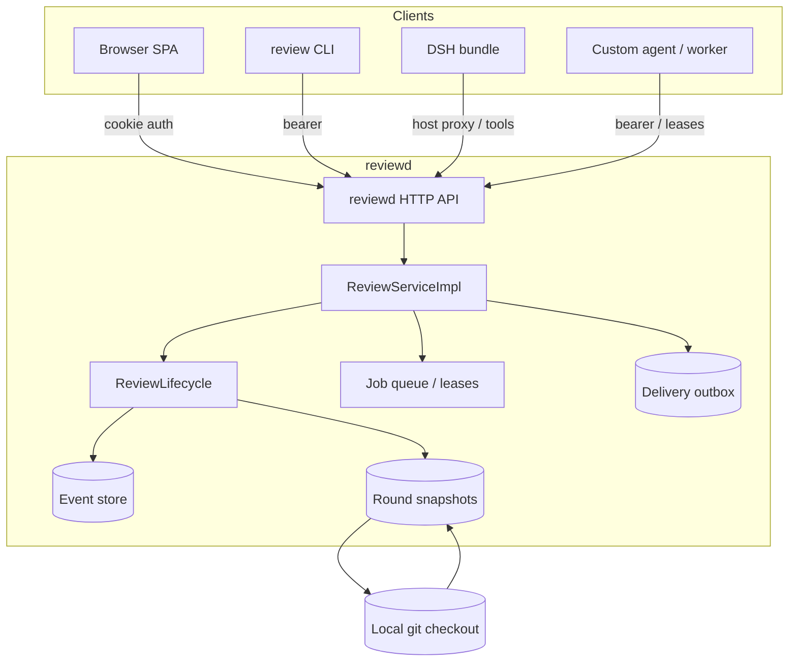

# Architecture

reviewd separates the review **service** from the interfaces that drive it. The service
owns review state; the HTTP daemon, CLI, browser UI, DSH bundle and workers are adapters.



## Components

| Component                 | Responsibility                                                                                        |
| ------------------------- | ----------------------------------------------------------------------------------------------------- |
| `@dsh-code-review/core`   | Review state, lifecycle, anchors, outcomes, feedback package, reviewer contracts and validation.      |
| `@dsh-code-review/server` | `reviewd` HTTP daemon, SSE/long-poll, jobs, workers, deliveries and the `review` CLI.                 |
| `@dsh-code-review/web`    | Vite/React review SPA served by `reviewd`.                                                            |
| `@dsh-code-review/worker` | Harness-agnostic lease loop: register, heartbeat, poll, post findings/report/ack and map failures.    |
| `@dsh-code-review/dsh`    | Cordis bundle: sidebar panel, `review_*` tools, `/review`, embedded/external daemon and DSH delivery. |

The core package has no HTTP, React, Cordis or DSH imports. Transports map requests to
`ReviewServiceImpl`; the UI never talks to the event store directly.

## Review state

A store root contains:

```text
lock                              single-writer lock (pid + createdAt)
reviews/<reviewId>/events.jsonl   append-only, versioned event log (source of truth)
reviews/<reviewId>/snapshot.json  atomically replaced replay cache
snapshots/<snapshotId>.json       immutable round snapshots
deliveries.json                   durable feedback delivery outbox
stream-cursor.json                durable daemon-wide SSE high-water mark
```

Every mutation appends one JSON event under a per-review mutex, fsyncs it, folds it into the
aggregate and then best-effort replaces the cache. Replay is authoritative:

- a torn final JSONL line is truncated on the next append and reported as `torn-tail`;
- corruption before the last line fails with the review id and line number;
- a stale lock must be removed manually after confirming the owner is gone.

Rounds are immutable. `refresh` writes a new snapshot, re-anchors every comment and records
a deterministic outcome. Comment ids, bodies, replies and anchor history survive the round.
See [Review state](reference/review-state.md) for the detailed model.

## Request flow

1. A client creates a review with a repository root and a scope (`range`, `commits`,
   `worktree` or `commit`).
2. The server builds an immutable snapshot from the local git checkout.
3. The reviewer worker or command backend receives a lease bundle and posts findings and a
   report; each step becomes an `agent/*` event.
4. A human comments, decides findings and submits a verdict.
5. Submit creates a deterministic feedback package and a durable delivery keyed by
   `reviewId:round:submissionId`.
6. The initiating harness or a fix agent reads the feedback, edits the code, calls
   `refresh`, and may resolve comments it actually fixed.
7. The next round re-anchors the remaining comments and records outcomes.

## Anchors and outcomes

A comment anchor stores the path, side, line or range, a quote and a content hash. On the
next round, reviewd tries, in order:

- the same path and line;
- rename and hunk mapping;
- a ±40-line quoted search;
- suggestion replacement as a fallback.

The result is one of `applied`, `addressed`, `unchanged`, `outdated` or `moved`, with a
confidence and the previous/current location. Agent claims, reviewer verification and human
decisions are separate signals; none silently overwrites another.

## Feedback and delivery

`submit` returns markdown and JSON generated without timestamps or randomness. The package
is capped at 100 KiB per format, includes open comments, accepted/dismissed findings,
suggestions, questions and verification, and is stable for a given round. The DSH host
injects it into the initiating session; CLI and HTTP clients read the same object.

Delivery records are persisted under the store root so a daemon restart does not lose a
queued submission or resurrect an acknowledged one. The delivery key makes retries
idempotent.

## Trust boundaries

- **Browser:** DSH session cookie or `reviewd` HttpOnly cookie; no bearer token in HTML,
  URLs or client code.
- **Machine clients:** `Authorization: Bearer` with the shared token.
- **Reviewer:** read-only snapshot and a bounded report schema; no repository writes.
- **Command backend:** argv array without a shell, minimal environment (no review token),
  bounded output and process-group termination on timeout.
- **Worker:** transport authentication belongs to the worker process; the token is not put
  into the reviewer prompt or harness environment.
- **Git:** read-only commands with inherited repository environment removed, external
  diff/textconv disabled and paths validated against the repository root.

See [SECURITY.md](../SECURITY.md) for the full threat model.

## Design choices

- **Event sourcing over mutable rows:** review history, decisions and agent claims remain
  auditable after edits, deletes and force-pushes.
- **One service, many adapters:** the CLI, UI, DSH and workers cannot drift into separate
  review semantics.
- **Deterministic feedback:** the next agent gets the same package for the same round,
  regardless of transport.
- **Single writer, local files:** simple backup/restore and predictable failure modes; no
  HA claim.
- **Explicit limits:** diff, file, line, content and body caps keep a single daemon
  predictable.

## Source map

```text
packages/core/       review state and contracts
packages/server/     daemon, CLI, jobs, workers, deliveries
packages/web/        React review SPA
packages/worker/     reusable worker lease loop
packages/dsh/        DSH Cordis bundle and client
tests/e2e/           Playwright browser and axe suites
scripts/             build, demo, package verification, docs checks
```

For contributor workflow and verification gates, see [CONTRIBUTING.md](../CONTRIBUTING.md).
