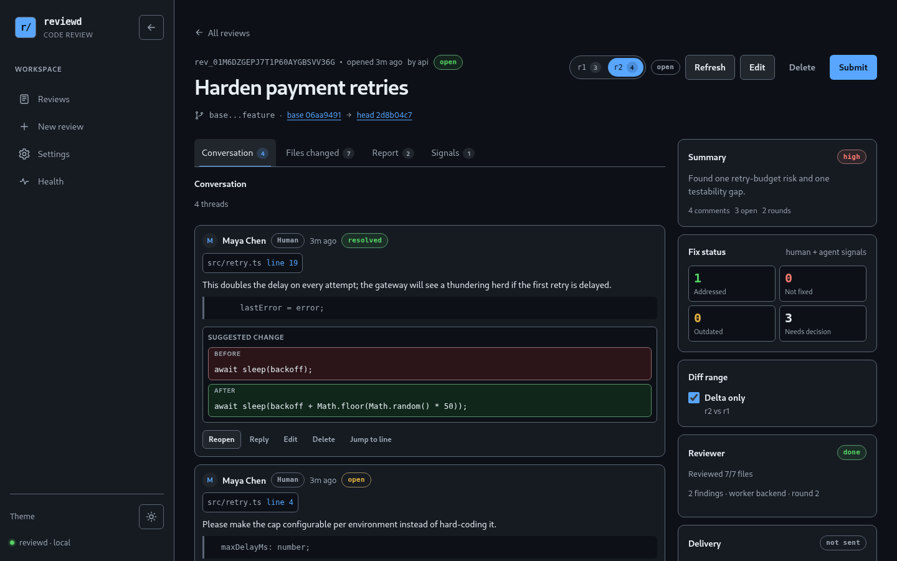
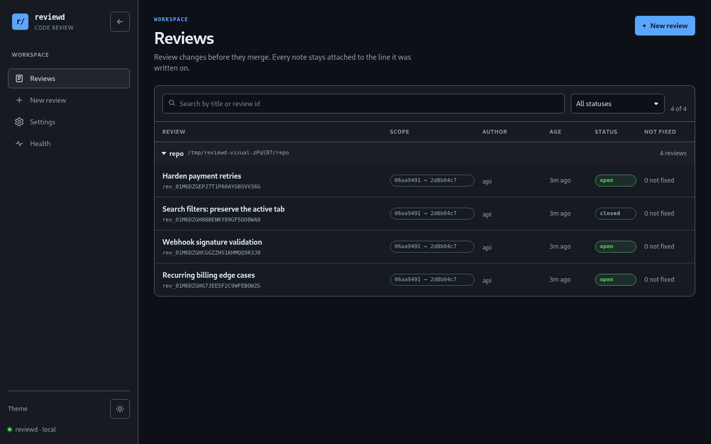
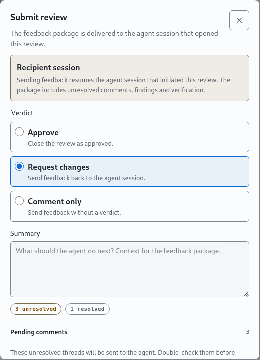

# Features

reviewd is built around one loop: **an agent opens a change, a reviewer finds problems, a
human decides what matters, and the next agent pass gets precise instructions**.



## At a glance

| Job to be done             | What reviewd provides                                                                  |
| -------------------------- | -------------------------------------------------------------------------------------- |
| Pre-review a change        | Independent reviewer worker, structured findings, evidence and suggestions             |
| Review precisely           | File/line/range anchors, quoted context, suggestions, replies, decisions               |
| Survive changing code      | Immutable rounds, re-anchoring across renames and force-pushes, outcome classification |
| Hand work back to an agent | Deterministic markdown/JSON feedback, delivery keys, DSH session delivery              |
| Close the loop             | Fix-agent comment resolution, refresh, verification evidence and round history         |
| Run it yourself            | Single-token self-hosted daemon, event-sourced local store, Docker and systemd paths   |
| Integrate any harness      | Native DSH bundle plus authenticated CLI and HTTP APIs for everything else             |

## Independent pre-review

A reviewer worker reads the diff, the changed-file manifest and surrounding code. It posts
findings as events, not as free-form chat:

- severity, title, rationale, evidence and an optional suggested replacement;
- line or range anchors that must exist in the snapshot;
- questions and a summary report;
- a coverage ledger that makes partial review explicit.

The reviewer is deliberately read-only. It cannot edit the repository or write arbitrary
review state; every step is appended as an `agent/*` event. `validateReport` rejects invalid
items individually instead of discarding the whole report.

**Why it matters:** a human can triage a review before reading every diff line, and a fix
agent gets structured work instead of a transcript.

## Review that survives force-pushes

Comments are anchored to a file, side, line or range, with a quote and a content hash. On
`refresh`, reviewd creates an immutable round and re-anchors every comment:

- renames and moved hunks are followed;
- a ±40-line quoted search recovers moved lines;
- suggestion replacement is used as a fallback;
- previous and current locations are both shown;
- every comment gets a deterministic outcome: `applied`, `addressed`, `unchanged`,
  `outdated` or `moved`.

Comments are never physically deleted. `resolved` and `dismissed` are soft states, and the
event log keeps the audit trail. Review metadata and comment text can be corrected while a
review is open; changing the scope starts a new round.

| Review list                                                                                          | Submit and hand off                                                                                 |
| ---------------------------------------------------------------------------------------------------- | --------------------------------------------------------------------------------------------------- |
|  |  |

## Agent findings and human decisions

Reviewer findings appear inline in the diff and in the full-file view. A human can:

- accept a finding, optionally with a note;
- dismiss it with a reason that tells the next agent **not to repeat it**;
- apply an accepted suggestion against the expected snapshot, with a stale check;
- reply in a thread, edit a comment or soft-delete it.

The latest decision for a round wins. Accepted findings remain actionable in feedback;
dismissed findings are excluded and listed with their notes. This is the difference between
"the model said something" and "a human decided this matters".

## Deterministic feedback for the next agent

Submitting a review creates a delivery with a stable key (`reviewId:round:submissionId`) and
a deterministic markdown + JSON package. It contains:

- open human comments and their anchors;
- accepted blocker/major findings and all accepted non-praise findings;
- dismissed findings with the human's note;
- accepted and applied suggestions (applied ones marked "do not reapply");
- questions, verification entries and a resolved summary.

The package has no timestamps or random values, so repeated reads and deliveries are
idempotent. DSH receives the package through the initiating session; CLI and HTTP clients
read the same content.

## Fix agents can reply and resolve comments

A fix agent can reply to a comment and mark it resolved after it has actually fixed the
issue. Both events are attributed to an **agent actor**, not silently rewritten as a human
action. The DSH tools are `review_reply_comment` and `review_resolve_comment`; the HTTP
routes are `POST /api/reviews/:id/comments/:cid/replies` and
`POST /api/reviews/:id/comments/:cid/resolve` with an optional `x-review-actor` header.

The fix loop is:

```text
feedback → edit code → run tests → refresh → review comments → reply → resolve what changed
```

Comment resolution does not replace human verification. Outcomes and fix claims are
separate signals; the review keeps both.

See [Run a fix agent](guides/run-a-fix-agent.md) for the full workflow.

## Harness-agnostic integration

| Harness                  | Integration                                                                |
| ------------------------ | -------------------------------------------------------------------------- |
| DSH 0.2.x                | Native bundle: sidebar panel, `review_*` tools, `/review`, reviewer worker |
| Claude Code / Codex / pi | Shell out to the `review` CLI or call the authenticated HTTP API           |
| Custom agent             | HTTP API with bearer auth, idempotency keys and worker leases              |
| Human                    | Browser UI served by the daemon                                            |

There is no MCP server in this release. The stable integration surface is the CLI and HTTP
contract; see [Connect an agent](guides/connect-an-agent.md).

## Review UI

The standalone SPA supports:

- real git diffs, delta/full views and round switching;
- an explicit merge-conflict banner and per-file badge for unresolved worktree conflicts;
- file, line, range and full-file comments, including lines outside the diff;
- draggable selection for a range and inline suggestions;
- collapsible repository groups and search/status filters;
- finding decisions with notes;
- deep links to files and lines;
- keyboard navigation, 320px layouts and light/dark themes;
- axe WCAG 2.1 A/AA checks in the browser suite.

Repository settings are stored on the daemon (mode `0600`) and let `/new` start a
merge-request-style review from a saved checkout and branch range. reviewd records the
boundary; it never merges, checks out or rewrites the target branch.

## Operations and audit

- Append-only event log per review; `snapshot.json` is a replay cache.
- Durable feedback outbox and daemon-wide SSE cursor.
- Single-writer store lock; torn-tail detection on replay.
- Docker image with non-root user, read-only rootfs and dropped capabilities.
- GC by age, backup/restore, token rotation and reverse-proxy guidance.

See [Deploy reviewd](guides/deploy.md) and [Review state](reference/review-state.md).

## What reviewd is not

- Not a GitHub/GitLab replacement or a merge bot.
- Not multi-tenant: one shared token, no user accounts or per-user audit identity.
- Not a model host: bring a reviewer worker, command backend or your own integration.
- Not HA: one local filesystem store and one writer.
- Not an automatic commit/push tool: applying a suggestion is a human action.

For release-specific limits, see the [README status section](../README.md#status-and-limitations).
