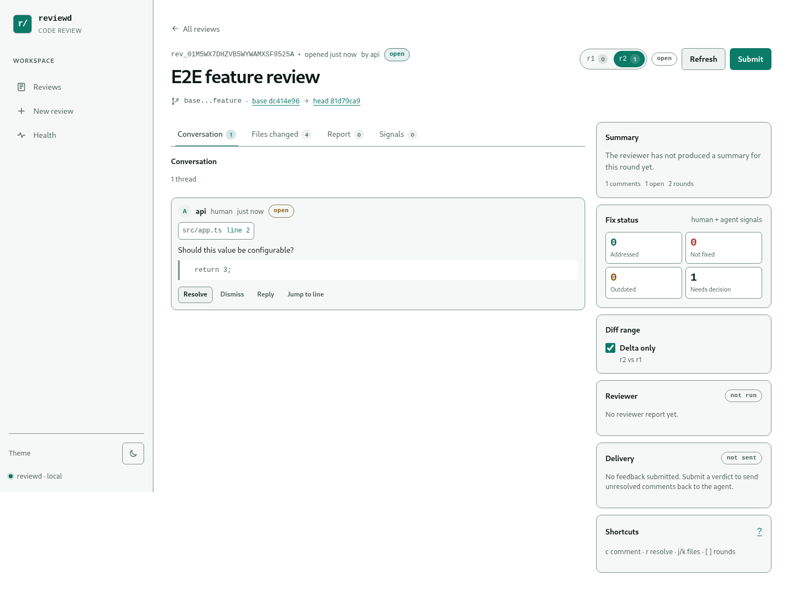
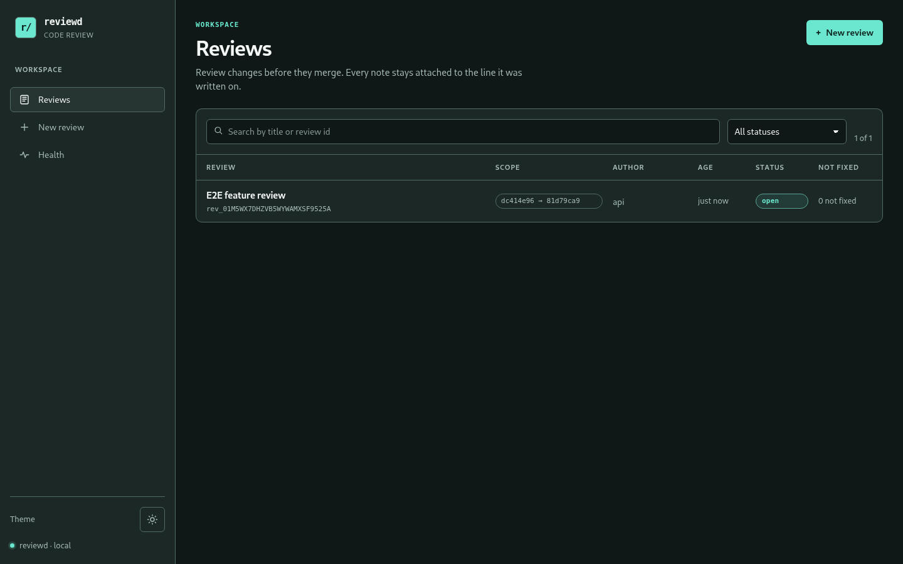
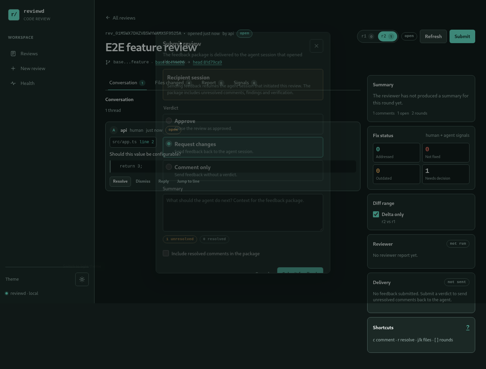

# Review a change

This guide follows the human review loop in the browser. For the command-line equivalents,
see the [CLI reference](../reference/cli.md).



## 1. Open the review list

Sign in with the daemon token. The landing page lists reviews by status and repository:



Use the search and status filters to find a review. Reviews are grouped by repository when
more than one checkout is configured. Each row shows the review status, round count and
comment count.

## 2. Create a review

Choose **New review** and provide:

- a saved repository, or a path visible to the daemon;
- a base branch and a source branch;
- all commits on the source side of the merge base, or an inclusive commit range;
- a reviewer backend (`worker`, `none` or a configured command backend).

The daemon resolves the refs and creates an immutable snapshot. `reviewd` records the
merge-request boundary only: it never merges, checks out or rewrites the target branch.

To save a repository path and default target branch, use **Settings**. The daemon validates
that each path is a git checkout and stores the list in `<store>/repositories.json` with
mode `0600`.

## 3. Read the diff

The review detail page has:

- **Conversation** — summary, rounds, feedback and submit controls;
- **Files changed** — delta or full diff, with repository groups;
- **Round selector** — switch between immutable rounds;
- **Findings** — reviewer output with accept/dismiss decisions.

The URL keeps the selected file and line, so a comment or finding can be linked directly:

```text
/review/<id>?round=2#file=src/app.ts&line=42
```

## 4. Leave a comment

Select a line or drag across a range. Comments can also be placed on full-file lines
outside the diff, on the current or base side. A comment can include:

- a body;
- a suggested replacement;
- a reply thread.

Anchors store the path, side, line or range, a quote and a content hash. When the source
changes, reviewd re-anchors the comment on the next round and shows both the previous and
current location.

## 5. Decide on agent findings

Findings appear in the diff and in the full-file view. For each finding you can:

- **Accept** it, optionally with an inline note;
- **Dismiss** it with a reason.

The latest decision for a round wins. Accepted findings stay actionable in feedback;
dismissed findings are excluded and their notes tell the next agent not to repeat them.
The decision is stored as an event, so the audit trail survives later edits.

## 6. Submit feedback

Open **Submit** when the review is ready:



Choose one verdict:

- **Approve** — closes the review;
- **Request changes** — keeps it open for another round;
- **Comment** — keeps it open without a blocking verdict.

Add a summary if the comments need context. Submit creates a deterministic markdown/JSON
feedback package and a durable delivery key. The initiating DSH session receives it
automatically; CLI and HTTP clients can read the same package with `review feedback`.

## 7. Refresh after fixes

After the author or a fix agent changes the code:

```bash
review refresh <id>
```

The refresh creates a new immutable round, writes a new snapshot, re-anchors every comment
and records an outcome (`applied`, `addressed`, `unchanged`, `outdated` or `moved`). The
review page updates through the event stream.

A comment can be resolved by a human in the UI or by a fix agent through the DSH tool or
HTTP endpoint. Resolution is a state transition, not a deletion; the comment and its
history remain in the event log.

## 8. Close or delete

- **Approve** closes the review with an approved verdict.
- **Close** closes it without claiming approval.
- **Delete** soft-deletes the review: it disappears from the list and API, but the event
  log is retained for audit. Deletion is idempotent.

Review metadata and comment text can be edited while the review is open. Changing the
review scope starts a new round instead of rewriting history.

## Keyboard and accessibility

- Deep links preserve file and line selection.
- The layout supports 320px widths and light/dark themes.
- The browser suite runs axe WCAG 2.1 A/AA checks and fails on serious or critical
  findings.
- Focus states and reduced-motion preferences are respected.

## Next

- [Run a fix agent](run-a-fix-agent.md) for the agent side of the loop.
- [Troubleshoot](troubleshoot.md) if submit or refresh fails.
- [Features](../features.md) for the complete behavior matrix.
