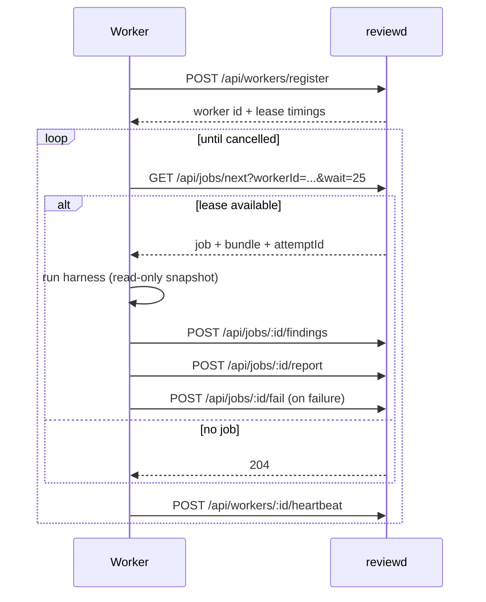

# Worker protocol

`@dsh-code-review/worker` is a harness-agnostic lease loop for reviewd jobs. It owns
registration, heartbeat, long-polling, findings/report/ack transport, stale-registration
recovery and generic failure reporting. It does not choose a model, build a prompt, spawn a
harness or write the review store.

A worker has two halves:

1. the transport loop in `@dsh-code-review/worker`;
2. a `HarnessRunner` that executes the job's prompt and returns structured findings.

## Lease flow



A lease lasts 60 seconds and a heartbeat every 20 seconds extends it. An expired lease is
requeued for at most two attempts; after that the job is `failed`. `attemptId` is the
idempotency key for findings, report and failure; duplicate posts are no-ops.

Worker steps are appended as `agent/started`, `agent/finding`, `agent/report` or
`agent/failed` review events, so the audit trail survives a daemon restart even though
queue leases are in memory.

## Bundle

The job bundle contains:

- `prompt` — the reviewer instructions;
- the read-only snapshot diff;
- `schema` — the report schema;
- `meta` — cwd and other run metadata;
- `protocolVersion` and `promptVersion`;
- `manifest` — the complete review manifest when available.

The worker validates the protocol and prompt versions before running. A missing version is
the legacy v0 lease; it is accepted during migration but new adapters must require v1. An
explicit unsupported version posts non-retryable `protocol-mismatch` and never runs the
runner.

## Findings and report

`report.findings` is canonical for both the final report and the incremental `/findings`
event. `normalizeRunnerResult` reconciles the two places a runner can return findings:

- result-level `findings` only — copied into the report and posted;
- `report.findings` only — used as-is;
- both non-empty and deeply equal — accepted once;
- both non-empty and different — rejected as non-retryable `invalid-output`;
- both absent or empty — empty findings, and the report gets `findings: []`.

The loop posts the canonical list to `/findings` (when non-empty) and the normalized report
to `/report`, so reviewd's report fold sees the same findings.

A report has `schemaVersion: 1`, a summary, findings and optional coverage. `validateReport`
is dependency-free and rejects invalid items individually: duplicate ids, bad enums, missing
snapshot paths, out-of-range lines and text over 32 KiB are dropped while the rest of the
report stays usable. A suggestion whose `original` does not match the snapshot after
whitespace normalization is dropped and the finding is marked `unanchored`.

## Failure mapping

| Condition                                           | Code                | Retryable |
| --------------------------------------------------- | ------------------- | --------- |
| Unknown runner error                                | `harness-failed`    | yes       |
| Invalid report shape/schema                         | `invalid-output`    | no        |
| Divergent result/report findings                    | `invalid-output`    | no        |
| Failed to submit findings/report/ack                | `report-failed`     | yes       |
| Unsupported lease `protocolVersion`/`promptVersion` | `protocol-mismatch` | no        |
| Aborted run                                         | no failure posted   | —         |

Stale worker registration (`401`/`403`/`404` or `unauthorized`/`not-found`) triggers one
re-registration. A successful poll re-arms that one retry; a second stale error before any
successful poll stops the loop.

## Security

- Transport authentication belongs to the worker process. Do not put the reviewd token in
  `lease.bundle.prompt` or the harness environment.
- The reviewer is read-only: the DSH worker guard allows only `read`, `grep`, `glob`,
  `review_status` and `review_feedback`; shell, write, network, delegation and
  review-mutating tools fail closed.
- Command backends run an argv array without a shell, with a minimal environment and
  process-group termination on timeout.
- Review comments and reviewer output are untrusted data; render them as text/code.

## Package contract

```ts
import { runWorkerLoop } from '@dsh-code-review/worker';
import type { HarnessRunner } from '@dsh-code-review/worker';

const runner: HarnessRunner = {
  async run(lease, signal) {
    return {
      findings: [],
      report: { schemaVersion: 1, summary: 'ok', findings: [] },
    };
  },
  cancel() {
    // best-effort process/session cancellation
  },
};

await runWorkerLoop(
  {
    api,
    identity: { harness: 'codex', name: 'codex-reviewer' },
    runner,
    pollMs: 2_000,
    heartbeatMs: 20_000,
  },
  signal,
);
```

`api.get('/api/jobs/next?...')` must return a flattened lease; reviewd returns
`{ job, bundle }`, so an adapter should return `{ ...payload.job, bundle: payload.bundle }`
or `null` when there is no job.

See the full adapter contract in
[packages/worker/README.md](../../packages/worker/README.md).

## Next

- [HTTP API: jobs and workers](http-api.md#jobs-and-workers)
- [Reviewer agent](../agents/reviewer.md)
- [DSH integration](../agents/dsh.md)
